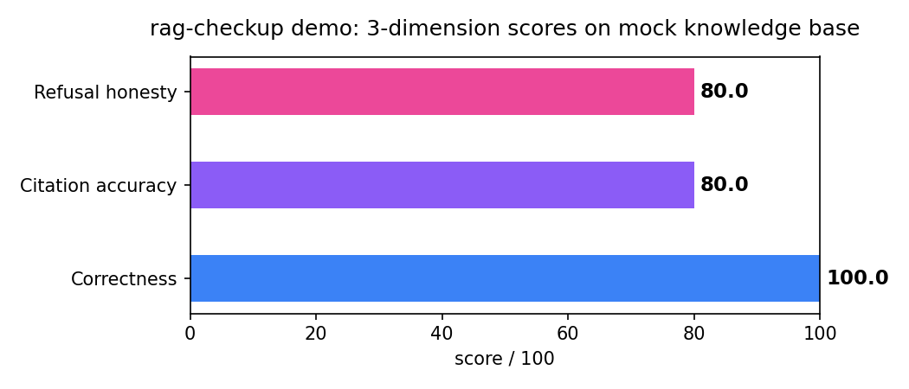

# rag-checkup 🩺

**10 分钟给你的线上知识库问答做一次"体检"——不用写代码。**

[](LICENSE)
[](pyproject.toml)
[](#)
[](#)

知识库搭好了，但它答得准不准，你心里没数。ragas 要写代码，deepeval 的用户在 issue 里求"一键向导"——rag-checkup 就是那个向导：连上你的 Dify / FastGPT 知识库，自动出题、打分、定位 bad case，出一份中文网页报告，还告诉你调哪个参数能涨分。



*上图为 `rag-checkup demo` 在内置 mock 知识库上的真实跑分；运行命令会在本地生成完整可交互 HTML 报告。*

## 30 秒快速开始（零 key）

```bash
pip install rag-checkup
rag-checkup demo   # 内置 mock 知识库,零 key 跑通全流程,生成 report.html
```

或者 Docker：

```bash
docker run --rm --user "$(id -u):$(id -g)" -v $(pwd):/out rag-checkup demo --out /out/report.html
```

## 连真实知识库

```bash
# Dify(推荐用 dataset-scoped API key,只授权单个知识库)
export RAGCHECKUP_DIFY_KEY="ds-your-key"
rag-checkup run -p dify --dataset-id YOUR_DATASET_ID

# FastGPT
export RAGCHECKUP_FASTGPT_KEY="your-key"
rag-checkup run -p fastgpt --dataset-id YOUR_DATASET_ID

# A/B 对比:同一测试集跑两套 top-k,看改参数涨多少分
rag-checkup ab -p dify --dataset-id YOUR_DATASET_ID --top-k-a 3 --top-k-b 10

# 英文报告
rag-checkup demo --lang en
```

### 使用 LLM 出题与裁判（可选）

```bash
pip install "rag-checkup[llm]"
export RAGCHECKUP_LLM_KEY="your-provider-key"
rag-checkup demo --llm
# 指定同一个模型用于 LLM 出题与裁判
rag-checkup demo --llm --model gpt-4o-mini
```

`--llm` 会让 LiteLLM 同时负责生成测试题和裁判；`RAGCHECKUP_LLM_KEY`
会作为显式 `api_key` 传给 LiteLLM。没有 key、未安装可选依赖或 LLM 调用失败时，
出题和裁判会分别回退到确定性的离线实现。

## 三维打分说明

| 维度 | 测什么 | 怎么测 |
|---|---|---|
| 答案正确性 | 答案对不对 | LLM-as-judge（结构化 rubric）/ 离线启发式 |
| 引用准确性 | 引用是否能定位到召回内容 | **确定性可定位检查**，不做语义蕴含判断 |
| 拒答诚实度 | 文档外问题是否瞎编 | 拒答话术检测 + LLM judge |

任一维度 < 60 即记为 bad case，可在报告里展开回放：问题 → 召回 chunks → 模型答案 → 扣分原因，一键复制。

## 和同类项目的区别

| | rag-checkup | ragas | deepeval | KnowEval |
|---|---|---|---|---|
| 形态 | 产品（CLI，一键出报告） | 库（要写代码） | 库 | 产品 |
| 首日支持 | Dify + FastGPT | 通用 | 通用 | 只做 KnowFlow/RAGFlow |
| 中英双语 | ✅ | 英文为主 | 英文为主 | 中文为主 |
| 诊断→调参建议闭环 | ✅（5 条规则） | ❌ | ❌ | ❌ |
| 引用校验 | 确定性匹配 | LLM | LLM | LLM |
| ragas 停更 8 个月 / deepeval 用户求 wizard，我们是来填这个坑的。KnowEval 只做 KnowFlow/RAGFlow 中文，我们首日支持 Dify/FastGPT，中英双语——直接写在对比表里，不阴阳。 |

## 隐私承诺

- API Key 只存在你的环境变量里，**不出内网**，不经过任何我们的服务器（我们也没有服务器）。
- 测试题、报告全在本地生成。单文件 HTML 报告，发群里就能看。

## FAQ

**Q: 没有 Dify/FastGPT 能用吗？**
A: 能。`rag-checkup demo` 内置 mock 知识库，零 key 跑通全流程，先看报告长什么样再决定。

**Q: Dify dataset key 只能检索，不能完整问答？**
A: 对。dataset 模式下答案取 top-1 召回片段（抽取式），测的是检索+引用质量——这正是 RAG 最痛的一环。如需端到端问答，加 `--app-key` 传入 Dify App key 走 chat 模式。

**Q: 打分准吗？**
A: 引用维度是确定性的可定位检查，但不会判断引用内容是否语义上支持答案。正确性/诚实度默认离线启发式（可解释、可复现）；有 key 时加 `--llm` 切 LiteLLM 出题与裁判（结构化 rubric，返回 score+reason JSON）。

## 路线图

- [x] v0.1: Dify/FastGPT 连接、三类出题、三维打分、单文件报告、A/B 对比、调参建议、中英双语
- [ ] RAGFlow 接入（官方在补切块体验，窗口 6–12 个月）
- [ ] 定时巡检（每天自动跑，分数掉了发告警）
- [ ] Web UI（一键体检的可视化入口）

## Contributing

欢迎 PR：新的连接器（放 `src/rag_checkup/connectors/` 实现 `KBConnector` 即可）、新的调参规则（`suggestions.py`）、新的报告语言（`i18n.py`）。测试全绿是合并前提：`pytest tests/`。

---

Apache-2.0 协议。如果它帮你抓到了 bad case，点个 ⭐ 吧。
